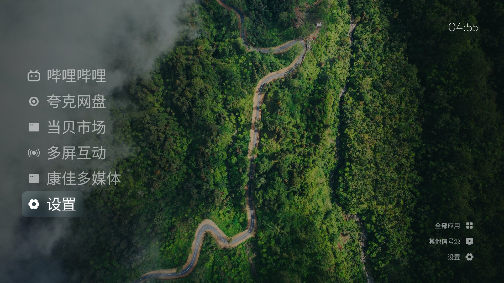

# 康佳 KKTV U65Q 电视改造项目

对康佳 KKTV U65Q（Android 5.1.1 / API 22 / RTD299O 芯片 / 1080p）做的三件事：

1. **Debloat（受固件限制，见实情说明）** —— 完整备份 + 分类 + 尝试禁用预装应用。**本机固件拒绝了所有 `pm disable-user`（SecurityException），也拒绝 `adb root`**，因此没有卸载/禁用任何系统包（符合"永不卸载系统包"原则）。唯一生效的改动是原装当贝桌面被 `pm hide`（由自研启动器接管，可随时 `pm unhide` 恢复）。
2. **自制归藏电视风格启动器（完成）** —— `com.appletvstyle.launcher`，参考 [op7418/guizang-tv](https://github.com/op7418/guizang-tv) 的设计语言（照片壁纸 + 细体大字列表 + 毛玻璃焦点），原生 Java 实现，minSdk 22，已是当前默认 Home。
3. **安装 TV 版应用（完成）** —— 哔哩哔哩 TV 版（云视听小电视 1.8.9）与夸克网盘 TV 版（2.9.1702），均验证可在 Android 5.1.1 启动。



## 电视实况（改造过程中确认）

| 项目 | 值 |
|---|---|
| 型号 / 芯片 | Konka_Android_TV_2991 / RTD299O (Realtek) |
| 系统 | Android 5.1.1（SDK 22），ART 运行时 |
| 分辨率 | 1080p，density 240 |
| 网络 | Wi-Fi 上网，ADB 10.10.10.27:5555（**已修复：重启后自动恢复**，见「网络 ADB 重启失效」节） |
| 原装桌面 | `com.dangbei.leradlauncher.rom`（当贝桌面 ROM 版，已被 `pm hide`） |
| 应用商店 | `com.dangbeimarket`（当贝市场） |
| 语音 | 科大讯飞 `com.iflytek.xiri` 生态 |
| 输入源切换 | 无标准 TV Input Framework（`tv_input` 服务不存在），靠广播 `com.konka.tvsettings.action.GO_TO_SOURCEPAGE` |
| 触摸 | 无触摸屏，全部遥控器 D-pad 操作 |
| Google 服务 | 无（无 Play Store / Play Services） |
| 内存 | 448MB 堆上限（启动器已按轻量设计） |
| **系统时钟** | **已修复**：固件自身 NTP 同步坏（无 RTC 硬件、默认 NTP 服务器在国内不可达、无手动设置 UI、adb 无 SET_TIME 权限）。已设 `ntp_server=ntp.aliyun.com` + `auto_time=1` 走系统 NetworkTimeUpdateService 自动对时，**每次开机联网后自愈**；启动器另内置 SNTP 兜底（见下） |

## 自研启动器（归藏电视风格）

包名 `com.appletvstyle.launcher`，源码在 `launcher/app/src/main/`，构建产物 `launcher.apk`（见 GitHub Releases）。

### 设计语言（参考 guizang-tv / CleanFrame）

- **照片壁纸背景**：内置 5 张照片（雾中雪岭 / 雨林山路 / 热带绿叶 / 山间彩虹 / 流光花影，Unsplash License，署名见 `launcher/app/src/main/assets/wallpapers/catalog.json`），左侧叠渐变压暗保证文字可读
- **细体大字纵向列表**：Outfit Light 32/38/42sp（设置内可调），单色图标 + 白字，默认六项（哔哩哔哩 / 夸克网盘 / 当贝市场 / 多屏互动 / 康佳多媒体 / 设置，未装的自动过滤）
- **毛玻璃焦点**：聚焦行贴上「按内容宽度包裹」的壁纸模糊（后台高斯模糊一次，焦点移动只做裁剪），未聚焦行淡化到 75%
- **右上大时钟**：Outfit Thin 30sp，24 小时制
- **右下操作区**：全部应用 / 其他信号源 / 设置
- **全部应用面板**：暗色圆角全屏列表，按中文名排序
- **其他信号源**：HDMI 1-3 / AV / 数字电视 / 模拟电视 / 轮播，选中发康佳信源页广播
- **设置面板**：壁纸轮播（开关 + 1/5/15/30 分钟）、文字大小、焦点毛玻璃档位、背景（照片/纯黑），左右键调整即时生效
- **壁纸轮播**：默认 5 分钟，700ms 交叉淡入，离开桌面暂停
- **D-pad 确定性导航**：列表上下移动、右进操作区、操作区左回列表、返回键先把焦点还给列表；**记住上次焦点**
- 轻量：进程 RSS ~49MB（含壁纸位图）

### 时钟「时间不同步」问题说明（重要，已彻底解决）

**根因**（逐层排除后确认，全部有实证）：

1. 电视固件**没有任何 RTC 硬件节点**（`/dev/rtc0`、`/sys/class/rtc` 均不存在，`/proc/devices` 里只有 Realtek 自定义的 major 254 `rtc` 字符驱动但无对应节点）→ 系统时间纯靠内核自启计时，**每次冷启动必然回到 1970-01-01**。
2. 固件的自动对时服务其实存在且 `auto_time=1`，但默认 NTP 服务器（`config_ntpServer`，pool.ntp.org 系）在本网络不可达 → SNTP 永远超时 → 时间永远不同步。
3. 无任何手动设置时间的 UI（通用设置/关于/工厂菜单全查过，标准 `android.settings.DATE_SETTINGS` 无 Activity 响应）；`date -s` 静默失败（shell 无 `CAP_SYS_TIME`）；`service call alarm 2`（setTime）被拒（shell 无 `SET_TIME` 签名权限）。
4. 内核里直接对 `/dev/alarm` 发 `ANDROID_ALARM_SET_RTC` ioctl 的路也实测不通：本机内核是 Realtek 3.10.19 的老版 staging alarm 驱动（'a' 魔数，常量从设备 `libandroid_servers.so` 里挖出 0x40086105 确认），驱动本身无权限检查，但**要求设备以 O_RDWR 打开**，而 `/dev/alarm` 是 `system:radio 0664`，shell 属于 others 只读 → `-EPERM`；mknod 自建节点也被拒（无 `CAP_MKNOD`）。

**修复方式（系统级、永久自愈）**：

```bash
adb shell settings put global ntp_server ntp.aliyun.com   # 换成国内可达的 NTP
adb shell settings put global auto_time 1                  # 已是 1；改它触发一次轮询
adb shell setprop ctl.restart zygote                       # 软重启框架（adbd 不受影响），
# 让 NetworkTimeUpdateService 重新读取 NTP 服务器（NtpTrustedTime 是启动时单例缓存）
```

- `ntp_server` / `auto_time` 存在 Settings.Global 里**重启保留**；每次开机联网后 ConnectivityService 触发 `NetworkTimeUpdateService` 轮询 → SNTP 对时 → 系统时间自动修正（已实测：软重启后时间立即变为真实时间，完整重启后同样自愈）。
- 验证：`date` 从 `Thu Jan 1 08:xx CST 1970` 变为 `Mon Oct 26 04:39 CST 2026`；B 站封面图/视频恢复加载（TLS 证书验证依赖系统时间，1970 时钟会导致 `SSLHandshakeException`）。

**启动器内的 SNTP 兜底**（`NetworkTime.java`，双保险，仍然保留）：

- 进入桌面时向 `ntp.aliyun.com` 等公共 NTP 服务器取网络时间（UDP 123），失败回退 HTTP `Date` 头（TCP 80）
- 算出「网络 − 系统」偏移，桌面时钟按校正后时间显示，**每 15 分钟重对一次**
- 系统时间正常后偏移归零，两者一致；无网络时回退系统时间

**开机窗口期应用列表自动补齐**（`HomeItems.reload()` + `HomeActivity` 四个触发点）：

冷启动后系统时间还停在 1970 的那几秒到几十秒里，PMS 会查不到当天新装的应用——B 站/夸克安装时系统时间就是 1970，`packages.xml` 里它们的时间戳（`ft=0x141888 / 0x153998`）记在完全不同于预装应用（`0xa7f8` 体系）的时间基上，康佳定制固件在这个窗口期对它们的查询行为异常（实测：重启后首屏列表缺这两项，按 HOME/BACK 让界面重建后才出现）。启动器的对策：

| 触发点 | 说明 |
|---|---|
| `NetworkTime.onSynced` | 启动器自己的 SNTP 对时成功 → 立即重查 PMS 补齐（与观察到的"时间同步后才出现"精确对齐） |
| `onResume` | 每次回到桌面重查一次 |
| 开机后 3s / 9s / 20s | 延迟兜底，应对 PMS 异步暴露，不依赖对时成功与否 |
| `PACKAGE_ADDED/REMOVED/CHANGED/REPLACED` 广播 | 装/卸/更新应用实时刷新 |

实测（`auto_time=0` 强制复现 1970 窗口）：系统时间 `Thu Jan 1 08:02 CST 1970` 状态下列表已完整显示哔哩哔哩/夸克网盘，桌面时钟显示 SNTP 校正后的真实时间 05:13（shots/80–82）。

### 网络 ADB 重启失效问题（已修复）

**现象**：每次完整重启后 `adb connect 10.10.10.27:5555` 连接被拒，必须进工厂模式把 ADB「先关再开」才恢复。

**机制链**（全部有实证）：

1. `/init.rc` 里 `service adbd` 是 `disabled` 的，注释明说 "adbd is controlled via property triggers in init.<platform>.usb.rc"——只有 `sys.usb.config` 含 `adb` 时（`on property:sys.usb.config=mtp,adb` 等触发器）才会 `start adbd`。
2. `sys.usb.config` 是非持久属性，每次开机由持久属性 **`persist.sys.usb.config`** 同步而来。
3. 本机 `persist.sys.usb.config` 的值是 **`mtp`**（不含 adb）→ 开机 `sys.usb.config=mtp` → 不触发 `start adbd` → adbd 不运行、5555 无人监听 → ADB 连接被拒。
4. `/system/build.prop` 里虽然有 `persist.service.adb.enable=1`（康佳本想默认开 ADB），但它只是**一次性触发开关**：写 1 会由 Realtek 组件把 `persist.sys.usb.config` 改成 `mtp,adb`，随后属性本身被清空（所以运行时 `getprop persist.service.adb.enable` 是空的，grep `/sbin/adbd`、`/init`、全部 init rc 均无该属性引用——它的作用面是 `persist.sys.usb.config`）。
5. 工厂菜单「先关再开」的必要性：UI 开关状态与 adbd 实际运行状态脱节（UI 认为开着、实际没起），直接点「开」被去抖忽略，必须「关」一次翻转状态、「再开」才真正写 `persist.sys.usb.config=mtp,adb` + `start adbd`。而如果哪个时点该值被改回 `mtp`，下次重启又会失效——这就是每次重启都要手动开的原因。

**修复**（一条命令，持久生效）：

```bash
adb shell setprop persist.service.adb.enable 1   # 触发一次，Realtek 组件会把 persist.sys.usb.config 改成 mtp,adb
```

**验证**：修复后连续两次完整重启，均未进工厂模式、未做任何操作，ADB 分别在 **48 秒 / 53 秒**自动恢复（`persist.sys.usb.config=mtp,adb` → 开机 `start adbd` → 5555 自动监听）。当前状态 `persist.sys.usb.config=mtp,adb` 已持久化，**以后每次重启 ADB 自动可用**。

### 已验证（截图 shots/41–84）

- 界面：照片壁纸 + 细体大字列表 + 毛玻璃焦点 + 右上时钟 + 右下操作区
- D-pad：列表上下、右进操作区、左回；输入源面板开关；设置面板 5 项调整即时生效
- 全部应用面板：中文排序、点击启动（当贝市场启动验证）
- 壁纸轮播：间隔改 1 分钟后实测切换（绿叶 → 花影 → 山路）
- HOME 键稳定进入启动器；**框架软重启（`setprop ctl.restart zygote`）与完整重启后均自动回到启动器**，时钟显示真实时间
- **系统时间修复后 B 站 TV 版完全可用**：首页封面图全部加载（ shots/68）、右上角时间正确（04:41）、视频详情页播放正常（720P 自动、进度 02:08/12:52，shots/69–73）、日志无 SSLHandshakeException
- **开机窗口期列表自动补齐**：`auto_time=0` 复现 1970 窗口后，不依赖按键，列表自动补全哔哩哔哩/夸克网盘（shots/76、80–82）；完整重启自愈两次复测（04:55、05:06）系统时间与列表均正确
- 冷启动后康佳信源恢复界面（AV/HDMI 无信号）可能盖在启动器之上，按一次返回键即退出到桌面（固件既有行为）

### 遥控器操作

| 按键 | 行为 |
|---|---|
| 上 / 下 | 列表内移动项目 |
| 右 | 列表 → 操作区（全部应用） |
| 左 | 操作区 → 返回上次应用 |
| 确认 | 打开选中项目 |
| 返回 | 关面板；焦点在操作区时先还给列表 |
| Home | 回到桌面（启动器） |

### 定制方法

| 需求 | 做法 |
|---|---|
| 改首页默认应用 / 顺序 | 编辑 `HomeItems.java` 的 `DEFAULTS` + `DEFAULT_LABELS`（最多 9 项，未安装自动过滤），重装后生效 |
| 改 dock/操作区图标 | 编辑 `HomeIcons.java` 的映射（单色矢量 `res/drawable/mark_*.xml`，可自行画） |
| 换壁纸 | 把图片放进 `launcher/app/src/main/assets/wallpapers/`，改 `catalog.json`，重新构建（构建时打包，电视端不能导入） |
| 调文字大小/轮播/背景 | 遥控器进 设置 面板直接调（存 SharedPreferences） |
| 改轮播默认间隔 | `HomeAppearance.java` 的 `minutes()` 默认值 |

### 重新构建与安装

**构建要求**：JDK 8+（javac / keytool）+ Android SDK（build-tools，aapt2 / zipalign / d8；platform android-22）。`build_apk.py` 按以下优先级解析工具链，换一台机器无需改代码：

| 环境变量 | 作用 |
|---|---|
| `KKTV_BUILD_ENV` | 构建环境根目录（默认用项目内 `build-env/`，体积大未随仓库分发） |
| `KKTV_JDK` | 指定 JDK 的 `bin` 目录 |
| `KKTV_BUILD_TOOLS` | 指定 build-tools 目录（默认取 SDK 里最高版本） |
| `ANDROID_SDK_ROOT` / `ANDROID_HOME` | 指定 Android SDK |
| `APK_KEYSTORE` | 指定签名密钥路径；不指定则用 `tools/debug.keystore`，**缺失时自动生成 debug 密钥** |

```powershell
# 构建（无 Gradle：aapt2 + javac + d8 + zipalign + apksigner）
python tools/build_apk.py launcher/app/src/main launcher.apk

# 安装（重启后 ADB 会自动恢复，直接连即可）
python tools/tv.py push launcher.apk /data/local/tmp/launcher.apk
python tools/tv.py shell "pm install -r /data/local/tmp/launcher.apk"
```

`tools/tv.py` 是 ADB 封装（每次调用自动 connect；注意 MSYS 路径坑：本地路径用 Windows 风格 + `MSYS_NO_PATHCONV=1`）。

### 构建踩坑记录（都实际踩过）

1. **support 库的 `libs/` 内部 jar**：`support-v4` 的 aar 里除了 `classes.jar` 还有 `libs/internal_impl-*.jar`，`ScrollerCompatImplIcs` 继承 `ImplGingerbread`，任何 API 级别都会引用 `ScrollerCompatGingerbread`——漏打包就 `NoClassDefFoundError`。（当前版本已完全移除支持库，纯框架实现，不再有此问题。）
2. **自定义 View 两参构造**：`View(Context, AttributeSet)` 里必须 `super(c, attrs)`，不能图省事 `this(c)`——否则 `android:id` 不生效，`findViewById` 全返 null。
3. **d8 多 dex**：d8 可能输出多个 dex，必须全部注入 APK。
4. **Java 8 API 陷阱**：Android 5.1（API 22）没有 `Map.putIfAbsent` / `getOrDefault`（API 24 才有），编译期不报错、运行期 `NoSuchMethodError`。老设备上要用 `containsKey` + `put`。
5. **字段/参数同名遮蔽**：构造函数参数与字段同名时，匿名内部类里解析到的是非 final 的参数，编译报 "must be final or effectively final"——构造参数换个名字（如 `selectedIndex`）最省心。
6. **字段初始化顺序**：`private final LinearLayout list = new LinearLayout(context);` 这类字段初始化器跑在构造函数体之前，`context` 还没赋值——放进构造函数里初始化。

## TV 版应用安装记录

| 应用 | 包名 | 版本 | 来源 | minSdk | 验证 |
|---|---|---|---|---|---|
| 哔哩哔哩（云视听小电视） | `com.xiaodianshi.tv.yst` | 1.8.9 (108900) | downkuai.com/android/135178.html（MD5 已核对） | 17 | 安装成功；**系统时间修复后完全可用**：封面图/视频播放/右上角时间均正常 |
| 夸克网盘 TV 版 | `com.quark.yun.tv` | 2.9.1702 | downkuai.com/android/177429.html（MD5 已核对） | 17 | 安装成功、可启动（同样受益于系统时间修复，TLS 验证恢复正常） |

- 两个首次运行的隐私协议弹窗**需要你用遥控器亲自点「同意」**（法律意义上的用户确认，不宜代点）。
- 夸克网盘 TV 版的入口 Activity 未导出，`am start -n` 直接指定会 SecurityException；用 `monkey -p com.quark.yun.tv -c android.intent.category.LEANBACK_LAUNCHER 1` 或桌面列表点击启动。
- 两个 APK 只在本地使用、**未随仓库分发**（版权原因）；MD5 与官方页公布值一致。
- 以前"重启后要进工厂模式先关再开 ADB"的问题已根治（见下节），现在重启后约 1 分钟内 `adb connect` 自动可用。
- **重要经验**：这台电视所有依赖 TLS 的 App（B 站图片/视频、夸克等）都受系统时钟影响——1970 时钟会让证书验证失败。系统时间修复方法见上文「时钟问题说明」。

## Debloat 实情与回退方案

**固件实况**：`pm disable-user --user 0 <pkg>` 对全部候选包返回 SecurityException；`adb root` 被拒（`ro.adb.secure=1`，shell 非 root）。**没有任何系统包被禁用或卸载。**

可用的软性手段（未代为执行，按需自选）：

1. **应用内隐私开关**：讯飞语音（`com.iflytek.xiri`）在 我的 > 隐私 里可关个性化推荐；当贝市场在 我的 > 设置 里可关资讯推送。
2. **后台限制**：设置 > 应用 > 选中应用 > 限制后台活动（康佳系统设置支持）。
3. **路由器层屏蔽**：在路由器 DNS/防火墙屏蔽遥测域名（`*.iflytek.com`、`*.dangbei.com`、`*.konka.com`），从网络层断连。
4. **恢复原状**：`tools/restore.ps1` 一键卸载启动器 + `pm unhide` 当贝桌面 + 重启。

## 目录说明

```
launcher/app/src/main/     启动器源码（Java + res + assets/wallpapers + assets/fonts）
tools/build_apk.py         无 Gradle 的 APK 构建脚本（SDK/JDK 路径可用环境变量覆盖）
tools/tv.py                ADB 封装（自动 connect）
tools/restore.ps1          一键恢复脚本（卸载启动器、恢复当贝桌面）
backup/                    改造前完整快照（包清单/getprop/dumpsys/settings）
docs/                      排查过程中的分析笔记与证据（debloat 清单 / 框架清单分析 / UI dump）
shots/                     全部验证截图（00–84，JPEG 压缩版）
LICENSE                    MIT 许可证
```

> 未入库的大件（都在 `.gitignore` 里）：`build-env/`（JDK + Android SDK，1.3G）、`tools/platform-tools/`（adb）、两个 TV 版 APK、从电视拉取的固件文件、`shots-original/`（截图 PNG 原图）。

## 开源许可

本项目以 [MIT](LICENSE) 许可证开源。

- 启动器代码、构建 / ADB 工具脚本、文档与验证截图：本项目原创
- 界面设计语言参考 [op7418/guizang-tv](https://github.com/op7418/guizang-tv)（归藏电视），在此致谢
- 壁纸来自 Unsplash（Unsplash License，署名见 `launcher/app/src/main/assets/wallpapers/catalog.json`）
- 界面字体 Outfit（Google Fonts，SIL Open Font License 1.1，随 APK 打包分发）
- 仓库**不包含**任何第三方二进制：康佳固件文件、哔哩哔哩 / 夸克 APK、adb 可执行文件均只在本地使用

## 附：改造前完整备份

`backup/` 下的 `packages-all.txt` / `packages-system.txt` / `packages-disabled.txt` / `packages-third.txt` / `getprop.txt` / `dumpsys-package.txt` / `dumpsys-activity.txt` / `settings-*.txt` 是改造前的完整系统状态，任何时候可对照恢复。
